# asn1-viz

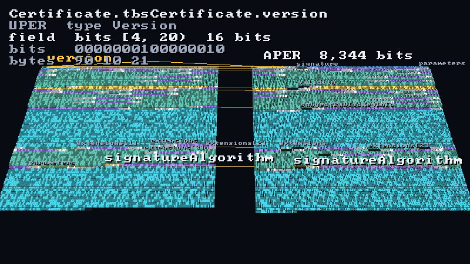

3D views of ASN.1 encodings and schemas, drawn on
[Strata](https://github.com/Preponderous-Software/strata) from what
[asn1c](https://github.com/dmccoystephenson/asn1c) actually does.

- **Bit-layout visualizer** ([Preponderous RFC 0023](https://github.com/Preponderous-Software/rfcs/blob/main/rfcs/rfc_0023_asn1c_bit_layout_visualizer.md)):
  the UPER and APER encodings of one value as side-by-side 3D strips, every
  segment (value, preamble bit, length determinant, alignment padding, ...)
  a block you can pick to see its field path and its bits.
- **Schema city** ([RFC 0024](https://github.com/Preponderous-Software/rfcs/blob/main/rfcs/rfc_0024_asn1c_schema_city.md)): an ASN.1 specification as a city, one district
  per module and one building per type, with references and recursion drawn
  as lines.
- **Compilation view** ([RFC 0034](https://github.com/Preponderous-Software/rfcs/blob/main/rfcs/rfc_0034_asn1c_compilation_view.md)):
  one `asn1c` run replayed over the schema city, stage by stage. Buildings
  rise as they are parsed, pulse as the fixer's passes visit them, and grow
  floors of generated C, one band per compiler function that wrote it.

RFCs 0023 and 0024 are implemented through their browser phases, and RFC 0034
through its trace (K0) and scene (K1); see
[Status and follow-ups](#status-and-follow-ups). **Try it in a browser:**
<https://asn1-viz.play.danielstephenson.dev>.

## The bit strips

```sh
./build/asn1-viz datasets/pkix/certificate.layout.json      # or no argument: the same file
```

Every bit of each encoding is a block, wrapped into rows like a hex dump,
with the codecs side by side (UPER left, APER right). A block's colour is its
segment's kind: presence bits, extension bits, choice indexes, lengths,
counts, APER's alignment padding, open-type wrapping, trailing padding. Values
are coloured by ASN.1 type family. Its height is the nesting depth of its
field, a 1 bit stands taller than a 0, and a dark top means the label is
inferred rather than observed. Click a block (ray picking through
`strata_raycast_meshes`) to see its field path, type, kind, bit range, bits
and bytes. The same field then glows in every lane, joined by a link. Press
**U** to widen the selection to the parent field, **N**/**P** to step
through segments, **F** to focus, **L** to link every field of one tree
depth across the lanes, and **H** to go home.

| | |
|---|---|
| 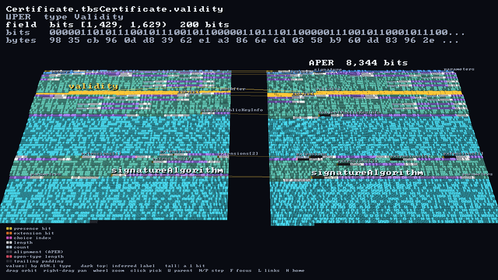 | 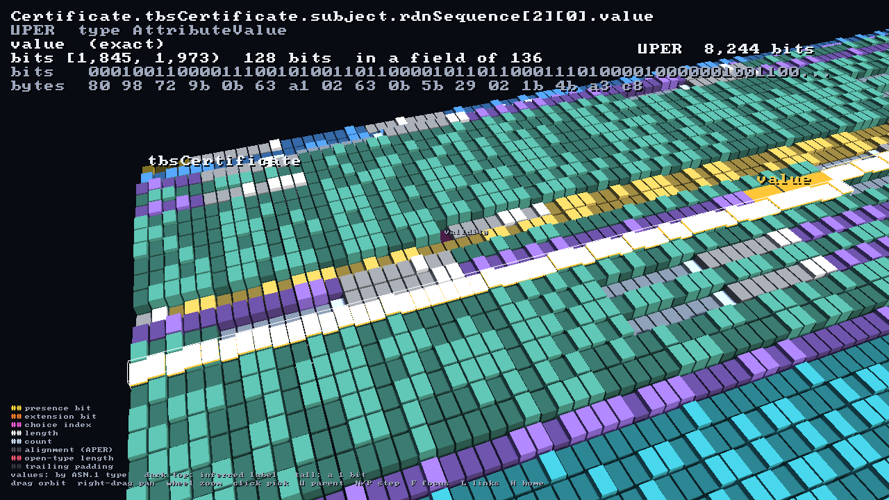 |
| The sample certificate, UPER (8,244 bits) and APER (8,344): `validity` selected in both, every depth-2 field linked across. | A click on the subject: `rdnSequence[2][0].value`, its bits and bytes. |

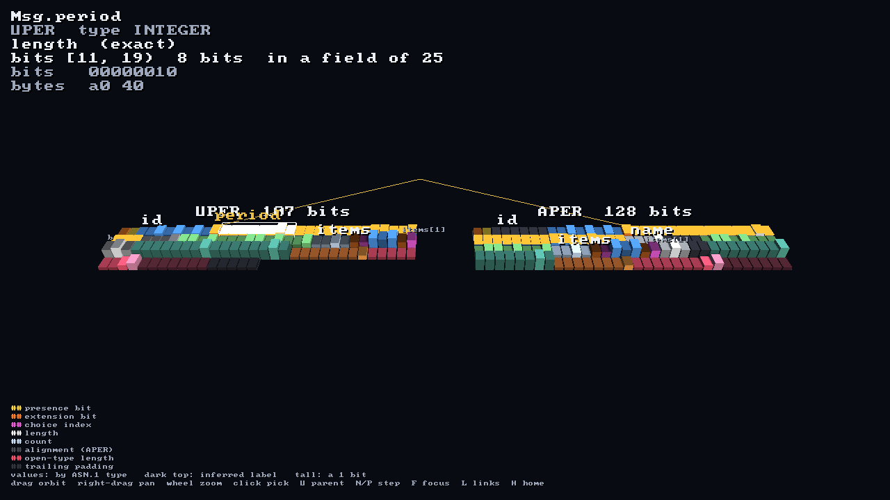

The demo message (`tests/fixtures/demo.asn1`) shows every structural
element in 107 UPER and 128 APER bits. Here `period`'s length determinant
is picked: 8 bits at [11, 19).

### The canonical-UPER overlay

asn1c has no separate canonical-UPER *encoder* (`asn_encode` sends canonical
UPER through the basic encoder). The fork's canonical work is on the
*decoder* side (`ctx.uper_canonical`). So the canonical view is an imported
encoding, laid out from the decoder side, with the fork's strict canonical
checks run over it:

```sh
./build/asn1-viz-extract-pkix --value cert.der --value-codec der --codecs uper \
    --import received.per --canonical --out check.layout.json
./build/asn1-viz check.layout.json
```

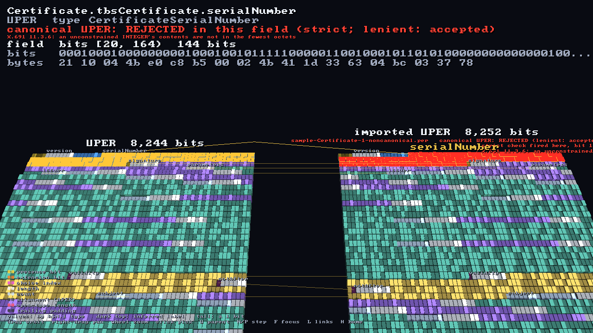

`datasets/pkix/certificate-canonical.layout.json` sets the fork's sample
certificate next to a copy whose `serialNumber` has one redundant leading
octet (made at build time by `asn1-viz-widen-integer`). The strict decoder
rejects the copy in `serialNumber`, at bit 164: X.691 11.3.6 requires an
unconstrained INTEGER's contents in the fewest octets. That field is capped
in red, and a post marks where the check fired. The lenient mode accepts the
copy, and the depth-3 links show every later field shifted by 8 bits. The
fork's own sample, imported, passes (`canonical UPER: ok`), and its
decoder-side frames match the encoder side bit for bit.

Headless, for documents and CI (EGL surfaceless; software GL works):

```sh
export LIBGL_ALWAYS_SOFTWARE=1 GALLIUM_DRIVER=llvmpipe
./build/asn1-viz --headless --shot out.png --pick Certificate.tbsCertificate.validity --links 2
./build/asn1-viz --headless --shot out.png --click 640 360          # what a click there picks
./build/asn1-viz --headless --tour frames/ --width 800 --height 450 && python3 tools/make_gif.py frames/ tour.gif
```

## The schema city

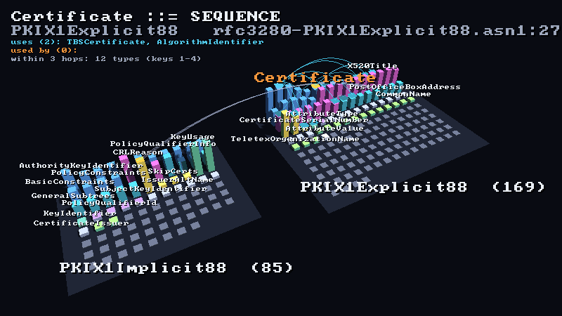

```sh
./build/asn1-viz datasets/pkix/schema.json          # RFC 3280's two PKIX modules
./build/asn1-viz datasets/recursion/schema.json     # asn1c's 92-circular-loops-OK test schema
```

An ASN.1 specification as a city.
Each module is a district, sized by its number of assignments and placed
next to the modules it imports from. Each type assignment is a building,
coloured by kind, its height the log of its member count. Values, value sets
and objects are flat tiles. IMPORTS are arcs between districts, drawn heavier
the more references cross them. Click a building to see its definition
(`file:line`), what it uses (cyan arcs) and what uses it (orange). Keys
**1**-**4** follow its references that many hops, which is how "what does
`Certificate` pull in" becomes visible. Types in a recursive group have a
glowing roof, and their references are drawn as red loops (**R** toggles
them).

| | |
|---|---|
| 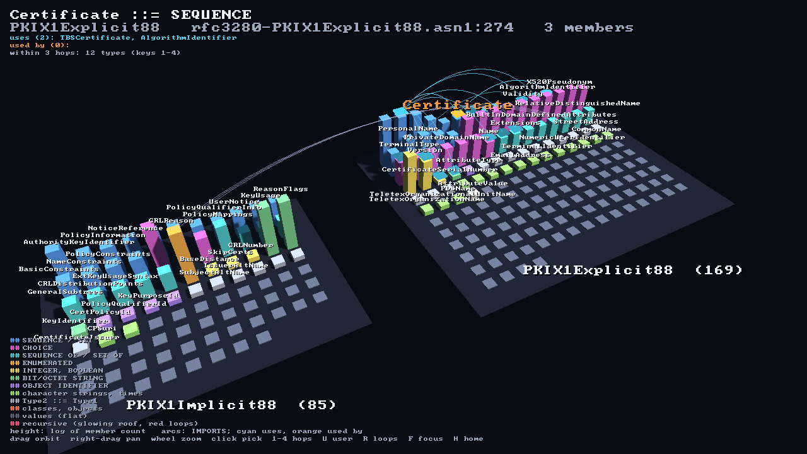 | 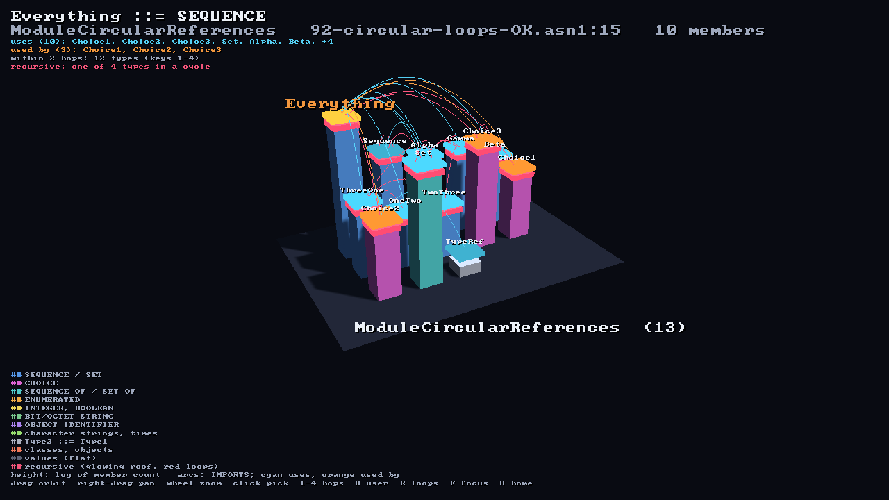 |
| PKIX: 2 modules, 126 types, 101 type-to-type references (6 across the IMPORTS arc). `Certificate` reaches 12 types within three hops. | `92-circular-loops-OK.asn1`: 13 types, 30 references, 3 recursive groups. `Everything` selected. |

The model comes from asn1c's own parser and fixer, not from its printed
output. `asn1-viz-schema` links `libasn1parser`/`libasn1fix` (built with the
fork's `config.h`), runs `asn1f_process`, resolves every reference with
`asn1f_lookup_symbol_ex` in the referring module's namespace (as the compiler
does), and finds recursion with Tarjan's SCCs. It writes `asn1-schema/1`
JSON. When a layout is opened, a `schema.json` beside it fills in the strip
view's `file:line`.

## The compile trace

```sh
./build/asn1-viz-compile-trace -S <asn1c>/skeletons --out compile.json --schema-out schema.json demo.asn1
./build/asn1-viz-compile-trace -S <asn1c>/skeletons --out no-oer.json --schema-name schema.json --flag -no-gen-OER demo.asn1
```

`asn1-viz-compile-trace` (RFC 0034 K0, `compile/trace.c`) records one asn1c
run as `asn1-compile/1` JSON, using asn1c's own libraries in-process, as the
`asn1c` driver runs them:

- **parse**: `asn1p_parse_file`; every assignment in parse order.
- **fix**: the tree printed (`libasn1print`, the `-E` form); the standard
  modules imported; `asn1f_process` with `A1F_DEBUG` and a logger that turns
  each debug line into an event (reporting function, schema line, asn1c
  `source:line`); the tree printed again (`-E -F`), with a unified diff per
  assignment the fixer changed.
- **compile**: `asn1_compile` with asn1c's default flags plus
  `-debug-output-origin-lines`, into a temporary directory that is deleted
  afterwards. Each generated file is counted per emitting compiler function
  (the `// asn1c_C.c:4166 emit_member_table()` origin comments) and tied to
  its assignment by asn1c's own file naming (`asn1c_make_identifier`).
- **save**: the skeleton files the compiler copied, with their sizes.

`--flag` (repeatable) passes one of asn1c's own code-generation flags on,
mapped to the same compiler and fixer bits as `asn1c/asn1c.c` maps them at the
pin: `-gen-X` / `-no-gen-X` for `OER`, `UPER`, `APER`, `BER`, `CER`, `XER`,
`JER`, `CBOR`, `print`, `random-fill` and `example`, and the `-f` flags that
only set bits (`-fcompound-names`, `-fwide-types`, `-fno-constraints`,
`-fbless-SIZE`, `-fprefer-import-source`, `-fall-defs-global`,
`-findirect-choice`, `-fline-refs`, `-fno-include-deps`, `-fincludes-quoted`,
`-funnamed-unions`). They are recorded in the trace's `flags`, after
`-debug-output-origin-lines`, so two traces of one schema can be compared
(below).

A stage that fails is recorded as `"failed"` (and the later ones as
`"skipped"`), and the trace is still written. With `--schema-out` the tool
also writes the `asn1-schema/1` walk of the same tree (the ids the trace
uses), with `codeBytes` filled: the bytes of each assignment's generated
`.c` and `.h`, not counting the origin comments (which carry asn1c's build
path), so the size asn1c writes without `-debug-output-origin-lines`. The PKIX and demo `schema.json` files come from it.

The format is RFC 0034 section 2's. Type ids are those of the `schema` file;
`type` is `null` where nothing is attributed. Fields beyond the RFC's
example (readers may ignore them):

| Where | Field | Meaning |
|---|---|---|
| top level | `inputs`, `parseStatus` | the schema files (basenames); `"ok"` or `"failed"` |
| `fix` | `result`, `warnings`, `fatals` | `asn1f_process`'s return value and diagnostic counts |
| `fix` | `printed` | lines of the whole `-E` / `-E -F` print, diff lines removed/added, assignments changed |
| `fix` | `attribution` | how many events each rule attributed |
| `fix.events[]` | `expr` | the identifier the message names, when it names one |
| `fix.events[]` | `how` | the rule that attributed it: `processing` (a `=== Now processing "X"` marker), `line` (the assignment holding the line the message names), `name` (the assignment the message names), `current` (the last assignment attributed in the same schema file) or `none` |
| `fix.diffs` | | only the assignments the fixer changed; hunks with `@@ -a,b +c,d @@` headers and two lines of context |
| `compile` | `result`, `totals`, `byFn` | `asn1_compile`'s return value; files, lines, annotated lines, attributed files, distinct `source:line`s; lines per function over all files |
| `compile.files[]` | `bytes`, `bySrc` | file size without the origin comments; lines per compiler `source:line` |
| `save` | `status`, `generated` | the helper files the compiler wrote (`pdu_collection.c`, `Makefile.am.*`, ...), with bytes and lines |

`compile.functions` is ordered busiest first. The events in asn1c's standard
modules (`ASN1-Object-Identifier-Module`, `ASN1C-UsefulInformationObjectClasses`)
and the files generated for their types (`EXTERNAL.c/.h`) are not in the
schema, so they stay unattributed.

What the pinned asn1c does (`tests/test_compile.cpp` asserts these; the fixer's
debug text is not an API, so an `asn1c.ref` bump that changes it fails there):

| | demo | PKIX |
|---|---|---|
| fixer events (unattributed) | 391 (251) | 7,835 (251) |
| busiest reporters | `asn1constraint_resolve` 136, `asn1f_resolve_constraints` 88 | `asn1constraint_resolve` 2,225, `asn1f_resolve_constraints` 1,070 |
| printed lines changed by the fixer | 7 of 19, in 2 assignments | 128 of 811, in 53 assignments |
| generated files, lines (annotated) | 6, 1,093 (971) | 254, 26,292 (21,208) |
| emitting functions, busiest | 23, `emit_member_table` 330 | 27, `emit_member_table` 4,783 |
| skeletons copied | 311 | 311 |

RFC 0034's Evidence was measured with a newer local asn1c build (7,812
events, 24,489 lines, 26 functions, 268 skeletons); the fixer's busiest
reporters and the PKIX print diff are the same at the pin.

## The compilation view

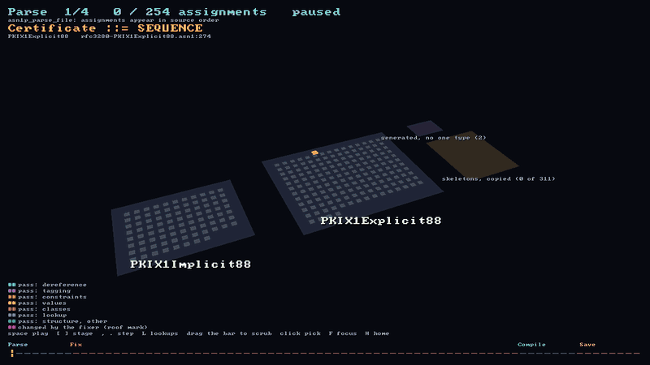

```sh
./build/asn1-viz datasets/demo/compile.json        # the demo module, played from the start
./build/asn1-viz datasets/demo/compile.json --at 1 --pick Msg/emit_member_table
```

How `asn1c` turns a schema into C, replayed over the schema city from an
`asn1-compile/1` trace ([RFC 0034](https://github.com/Preponderous-Software/rfcs/blob/main/rfcs/rfc_0034_asn1c_compilation_view.md)
section 2). A scrubber along the bottom spans the four stages:

- **Parse.** Each building starts as a flat footprint and rises when
  `asn1p_parse_file` reaches its assignment, in source order.
- **Fix.** A playhead walks the fixer's debug events (`-Wdebug-fixer`). The
  building each event names pulses, coloured by pass family: dereference,
  tagging, constraints, values, classes, lookup, or structure. **L** takes
  the lookup events (`asn1f_lookup_symbol_impl`, `asn1f_find_terminal_thing`;
  heavy traffic, not edits) off the timeline. Once the fixer is done with a
  type whose printed form it changed (`-E` against `-E -F`), its roof gets a
  pink mark, and the panel shows the first changed line before and after.
  The panel names the current event as `function (Type) - asn1c source:line`.
- **Compile.** Each building is replaced by a stack of floors, one band per
  compiler function that emitted lines into its files
  (`-debug-output-origin-lines`), each band as tall as its line count, grey at
  the bottom for unannotated lines. Files no one type owns stand on their own
  plot beside the city. Click a band for the function and its line count.
- **Save.** The skeletons `asn1c` copies rather than generates fill a
  "library" at the city's edge, one block per file, sized by its bytes.

**Space** plays and pauses, **[** and **]** step a stage, **,** and **.**
step one event (or assignment, file, skeleton), and dragging or clicking the
scrubber seeks; **H** goes home and **F** focuses the selection. **C**
switches to compare mode when a second trace is loaded (below). Every building, band, shared file and
skeleton is pickable; the panel says what has happened to the picked type so
far: its fixer events by family, its diff, and its generated lines by
function. The scene stays within a handful of Strata meshes however big the
schema is: one per district, one for the library and one for the marks, each
rebuilt as the playhead moves.

| | |
|---|---|
| 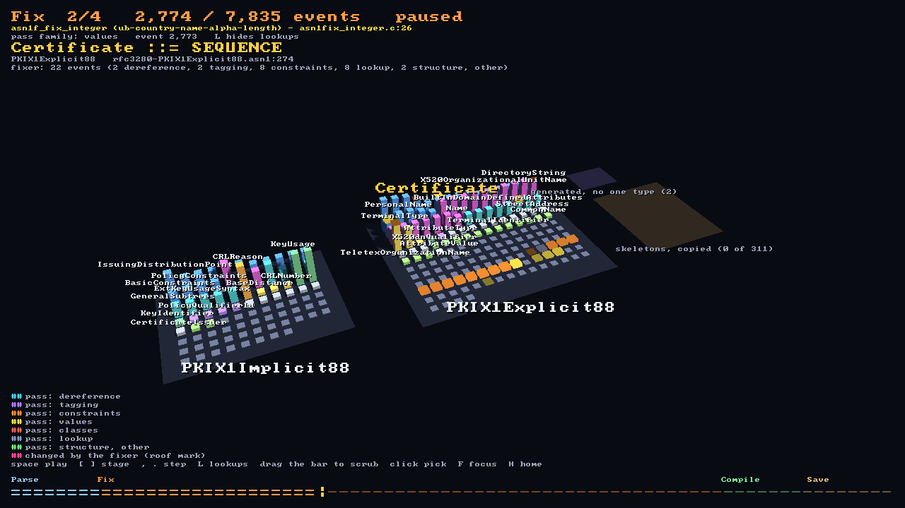 | 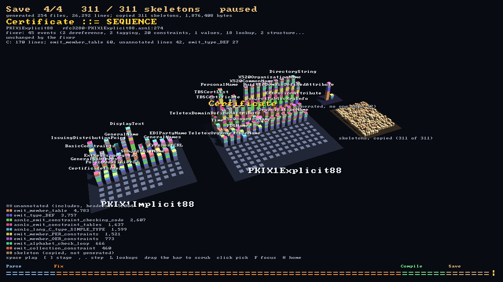 |
| PKIX at fixer event 2,774 of 7,835: the newest visits pulse in their pass family's colour. | After the run: 254 files, 26,292 lines from 27 functions (`emit_member_table` 4,783 lines), and 311 skeletons copied. |

The traces are `asn1-viz-compile-trace`'s (above): `datasets/demo/compile.json`
is the one the browser page plays, and `datasets/pkix/compile.json` is the
one in the pictures (`./build/asn1-viz datasets/pkix/compile.json`).

### Compare mode

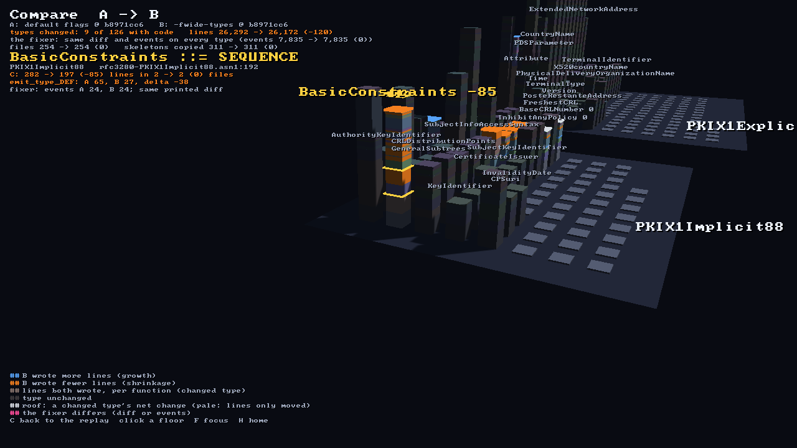

```sh
./build/asn1-viz --compare datasets/pkix/compile.json datasets/pkix/compile-fwide-types.json
./build/asn1-viz --compare datasets/demo/compile.json datasets/demo/compile-no-gen-OER.json --pick Msg/emit_member_OER_constraints
```

Two `asn1-compile/1` traces of the same schema (RFC 0034 G4), A and B, drawn
as one city: two `asn1c.ref` pins, or one pin with two flag sets. B must have
parsed the same assignments as A (`matches` on A's schema, and the same parse
order), or it is refused. Each building is a stack of floors, one per emitting
function (unannotated lines at the bottom), each as tall as the larger of its
A and B line counts:

- the lines both runs wrote, in a muted tint of the function's colour; a type
  whose lines did not change at all is grey;
- above them, the difference: **blue** for lines only B wrote (growth),
  **orange** for lines only A wrote (shrinkage). Blue against orange differs
  in hue and in lightness, so it reads without red against green, and stays
  clear of the selection's gold and the fixer's pink;
- a changed type's roof in the colour of its net change (pale when lines only
  moved between functions), and a pink roof tile where the fixer treated the
  type differently: its `-E` / `-E -F` diff, or the number of fixer events
  naming it.

Click a floor for the function and its A lines, B lines and delta; the panel
sums up the pair: types changed, total lines A → B, fixer differences, files
and skeletons copied. **C** goes back to A's replay (and again to the
comparison), keeping the selection.

The committed pairs are the pinned asn1c with one flag changed, so the
difference is the flag's (`tests/test_compare.cpp` asserts these):

| | A | B | What changes |
|---|---|---|---|
| demo | `compile.json` | `compile-no-gen-OER.json` | Both types lose their `emit_member_OER_constraints` lines (Msg 25, Item 16; 5 more in `EXTERNAL`): 1,093 → 1,047 lines, and 311 → 291 skeletons copied (the `*_oer.c/.h` support code). The fixer runs the same. |
| PKIX | `compile.json` | `compile-fwide-types.json` (the flag the PKIX layouts are built with) | 9 of 126 types with code change, 26,292 → 26,172 lines. INTEGER becomes `INTEGER_t` instead of a native `long`: constrained INTEGERs (`SkipCerts`, `BaseDistance`, `CRLNumber`) drop their native-type code (`asn1c_lang_C_type_SIMPLE_TYPE` 34 → 27, `asn1c_lang_C_type_common_INTEGER` 5 → 0) and gain constraint checking (15 → 20); `BasicConstraints` shrinks most (282 → 197; `emit_type_DEF` 65 → 27); `TBSCertificate` and `GeneralSubtree` grow by 2 (`try_inline_default` for their `DEFAULT`s); `InhibitAnyPolicy` and `BaseCRLNumber` only move lines between functions. |

No flag at the pin changes what the fixer does to these schemas (a fixer flag
adds one unattributed debug line), so neither pair has a pink tile; the mark is
tested on an edited trace. The browser page offers the demo pair behind the
Compilation view's **Compare** button; the PKIX pair is left out of the page's
download.

## In a browser

The same views on Strata's WebGL 2 backend (Emscripten), with the committed
datasets built in. Nothing is compiled in the page. Every push to `main`
deploys it to <https://asn1-viz.play.danielstephenson.dev> (arcade, through
`browser.yml`).

| | |
|---|---|
| 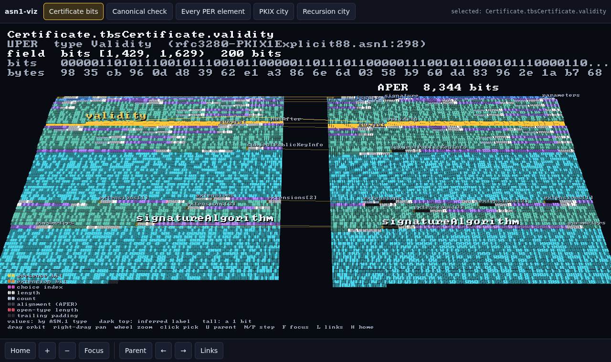 | 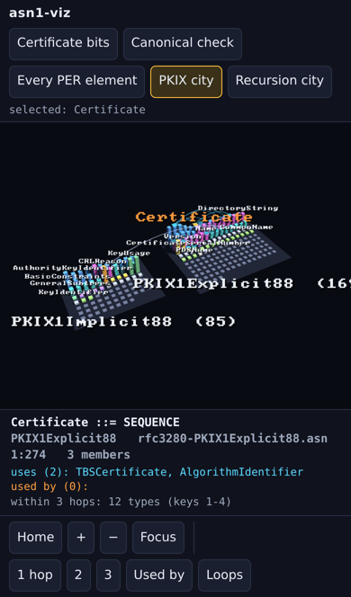 |

```sh
# emsdk 6.0.11 (Strata's pin); with an older system Python, point EMSDK_PYTHON
# at Python 3.10+ before sourcing emsdk_env.sh, and again after.
source /path/to/emsdk/emsdk_env.sh
emcmake cmake -S . -B build-web -DCMAKE_BUILD_TYPE=Release -DASN1VIZ_WITH_STRATA=OFF -DASN1VIZ_WEB=ON
cmake --build build-web -j8
ctest --test-dir build-web                      # the model tests, as wasm under Node
# serve build-web/asn1-viz.html (+ .js, .wasm, bench.js) as index.html; ?set=0..5 picks the dataset
```

Six datasets sit behind the buttons: the certificate's bits, the canonical
check, every PER element (the demo message), the PKIX city, the recursion
city and the compilation replay of the demo module, with play, step and
stage buttons and a range for the scrubber (the canvas's own scrubber takes
a tap too). Drag to orbit, right-drag or two fingers to pan, wheel or the +/-
buttons to zoom, and click or tap to pick. On a narrow screen the pick panel
moves from the canvas into a sheet under it, and the canvas draws at most two
pixels per CSS pixel. CI builds the page, runs the tests under Node, and
smoke-tests it in headless Chromium on a desktop, an iPhone 13 profile and a
phone at device pixel ratio 2. Every dataset must open and draw, a real click
or tap must change the selection, and a click or tap on a block must pick the
same block as the page's own pick call at that point (device pixel ratios 1, 2
and 3). The compilation replay must play, pause, step a stage, and seek from
the range and from a click or tap on the canvas's scrubber.

To measure the frame rate on a real device, open the page with `?bench`
(<https://asn1-viz.play.danielstephenson.dev/?bench>). It flies one fixed
orbit of the PKIX city for 15 seconds after a short warm-up, then shows the
frame rate, the frame time (median and p95), the page's own work per frame,
the GPU time where the browser offers WebGL 2 timer queries, the canvas size
and device pixel ratio and the GPU's name, with a button that copies it all as
text. `?bench=30` runs for 30 seconds. Nothing is sent anywhere. CI checks that
a run finishes and shows its card on a desktop and a phone profile; it keeps no
numbers, as headless Chromium draws on the CPU.

### The loading shell

The page loads behind the Strata web kit's loading shell
(`web/strata-kit/strata-loader.js`, vendored from Strata at the commit in
`web/strata-kit/PIN`; `web/strata-kit/update.sh <sha>` re-vendors it). It shows
the trailer's first frame (the one on <https://danielstephenson.dev/play>) as a blurred backdrop and real progress with the size ("0.5 of 1.3 MB"). The loader streams
the `.wasm` and hands its bytes to the engine, so nothing downloads twice. If
asn1-viz can't run (no WebGL 2, the renderer fails, the engine stops, a lost
WebGL context does not come back), the shell says why, and plays the trailer instead (the still under `prefers-reduced-motion`).
A device that draws under 12 frames a second is offered the clip without
losing the live view (not in automated browsers or `?bench` runs).

`web/strata-boot.js` bridges this classic (non-`MODULARIZE`) build to the
loader: emcc's script tag sits inert in `<template id="strata-glue">`, the
bridge starts it, and the engine waits in `Module.instantiateWasm` for the
loader's bytes. After each link, `web/strata_page.cmake` puts the loader and
the bridge inline in the page (so the site is still the same four files) and stamps the download's size on the
template, because the arcade compresses on the fly and sends no
`Content-Length`.

## The extractor

`asn1-viz-extract-<dataset>` decodes a value with an asn1c-generated codec,
encodes it in UPER and APER with a tracer in the loop, and writes an
`asn1-layout/1` JSON file: every encode call as a frame (field path, ASN.1
type, bit span) and every bit of the stream in exactly one segment (value,
presence bit, extension bit, length, count, alignment, choice index, open-type
length or padding, trailing padding). asn1c is used unmodified:

- **Tier 1**: a shim is written into each type's PER op table, so every
  type-level encode is seen with its start and end bit.
- **Tier 2**: the bit writers and the length, normally-small and alignment
  helpers are wrapped at link time (`-Wl,--wrap=...`), so every write is seen
  with its exact position and the helpers label theirs.
- **Tier 3**: bits a constructed type writes itself (a SEQUENCE's extension
  and presence bits, a CHOICE index, a leaf's extension bit, a constrained
  string's length) are labelled from the type descriptor in X.691 order and
  marked `"source": "inferred"`.

Open types and canonically sorted `SET OF` elements, which asn1c encodes into
separate buffers first, are relocated to where their bits land. Every run
self-tests: the segments tile the stream with no gap or overlap, the traced
bytes equal an untraced encoding, and the root span equals the encoded
length. If any check fails, nothing is written.

```sh
./build/asn1-viz-extract-pkix --value sample-Certificate-1.der --value-codec der --out cert.layout.json
python3 tools/layout_png.py cert.layout.json cert.png      # a flat 2D look (Pillow)
```

## Datasets

| Dataset | Schema | Value | In this repository |
|---|---|---|---|
| `pkix` | RFC 3280 `PKIX1Explicit88` + `PKIX1Implicit88`, extracted at build time from the pinned fork's `examples/rfc3280.txt` with its `crfc2asn1.pl` | the fork's `sample-Certificate-1.der` | `datasets/pkix/certificate.layout.json` (UPER 1,031 octets, APER 1,043; both byte-identical to the fork's own `.per`/`.aper` samples) |
| `demo` | `tests/fixtures/demo.asn1` (written for this repository) | `tests/fixtures/demo-msg.xer` | `datasets/demo/msg.layout.json` |
| `pkix` (city) | as above | | `datasets/pkix/schema.json` |
| `recursion` (city) | the fork's `tests/tests-asn1c-compiler/92-circular-loops-OK.asn1` | | `datasets/recursion/schema.json` |
| `pkix`, `demo` (compile trace) | as above | | `datasets/{pkix,demo}/compile.json`, with `schema.json` beside each; the compilation view replays them |
| `pkix`, `demo` (compare pairs) | as above | | `datasets/pkix/compile-fwide-types.json`, `datasets/demo/compile-no-gen-OER.json`: the same pin with one flag changed, for compare mode |

The committed layouts are what the pinned fork produces: CI regenerates them
and fails if they differ (`cmake --build build --target update-datasets`
refreshes them after a deliberate pin bump).

Not shipped, as follow-ups: **LTE RRC** (3GPP TS 36.331; not in the fork, and
3GPP's redistribution terms are unverified), **ETSI ITS CAM/DENM** (terms of
the ASN.1 on forge.etsi.org unverified), and the fork's **UMTS RRC 7.1.0**,
whose header forbids redistribution. Layouts embed field names and values,
so none of these is committed or published until its terms are confirmed.

## Building

Needs CMake 3.24+, a C++17 compiler, and (for the extractor, Linux only)
autotools, bison and flex to build the pinned asn1c fork.

```sh
cmake -S . -B build            # fetches asn1c at asn1c.ref and Strata at strata.ref
cmake --build build -j8
ctest --test-dir build --output-on-failure
./build/asn1-viz               # a window: drag to orbit, right-drag to pan, wheel to zoom, click to pick
```

Headless (no display; EGL surfaceless, software GL works):

```sh
LIBGL_ALWAYS_SOFTWARE=1 GALLIUM_DRIVER=llvmpipe ./build/asn1-viz --headless --shot out.png
```

On Windows (MSVC) the viewer and its tests build; the extractor does not
(it needs the fork's autotools build and GNU ld's `--wrap`), so the viewer
reads the prebuilt files in `datasets/`.

### Pins

| File | What | Bump |
|---|---|---|
| [`asn1c.ref`](asn1c.ref) | the `dmccoystephenson/asn1c` commit (on `vlm_master`) used to generate code and build `libasn1*` | a deliberate PR; CI reruns every dataset's self-test |
| [`strata.ref`](strata.ref) | the Strata commit (v0.4.0, ABI 1.8) | a deliberate PR |

Local checkouts replace either download:
`-DFETCHCONTENT_SOURCE_DIR_ASN1C=<path>` (an unconfigured tree) and
`-DFETCHCONTENT_SOURCE_DIR_STRATA=<path>`.

## Status and follow-ups

| RFC phase | Status |
|---|---|
| 0023 P0: repository, `asn1c.ref`, `strata.ref`, CI | done (#1) |
| 0023 P1: extractor, Tier 1 + 2, open types, self-test | done (#2), plus SET OF sorting buffers |
| 0023 P2: Strata strips, picking, labels | done (#3) |
| 0023 P3: decoder side, canonical overlay | done for UPER (#4) |
| 0023 P4: Tier 3 inference | done (inferred labels, marked); exact labels need fork ask F1 |
| 0023 P5 / 0024 C3: browser build of the redistributable datasets | done (#6) |
| 0024 C1: model from `libasn1parser`/`libasn1fix`, SCCs | done (#5) |
| 0024 C2: districts, buildings, references, recursion | done (#5) |
| 0024 C3: cross-link with the strips | `file:line` in the strip view's pick panel (#5) |
| 0034 K0: `asn1-viz-compile-trace`, `asn1-compile/1`, golden tests, `codeBytes` | done (#13) |
| 0034 K1: scene: stage scrubber, pulses, diff marks, floors, skeleton library, picking (native and browser) | done |
| 0034 K2: compare mode (G4): `--flag` in the trace tool, flag-set pairs for the demo and PKIX, `--compare`, **C**, the page's Compare button | done; checked with flag sets at one pin (a second `asn1c.ref` in CI is out of scope) |
| 0034 K3: browser datasets (PKIX), README pipeline diagram | the demo trace is in the page; PKIX is not yet |

Follow-ups, not done here:


- **Datasets:** LTE RRC (3GPP TS 36.331) and ETSI ITS CAM/DENM, once their
  redistribution terms are confirmed (RFC 0023 OQ3/OQ4). The fork's UMTS RRC
  7.1.0 says "DO NOT REDISTRIBUTE", so it is only used locally as a stress
  check (2,335 types walked in 0.25 s; its sample `DL-DCCH-Message` lays out
  and passes the canonical check).
- **Fork asks** (RFC 0023 F1/F2): an opt-in PER trace macro would make the
  inferred labels exact; the bit position in `-P` output. Not filed.
- **Code-size building height** (RFC 0024 OQ2's alternative): `codeBytes`
  is filled for PKIX and the demo (RFC 0034 K0), and still `null` for the
  recursion dataset; the city does not use it yet.
- **The extractor in the page** (RFC 0023 OQ8's second option), so a visitor
  can paste a value.
- **APER import**, fragmented open types (16K octets or more), BER/DER and
  OER lanes (RFC 0023 section 7).

## Licence

MIT (see [LICENSE](LICENSE)). asn1c is BSD-2-Clause; see
[THIRD-PARTY.md](THIRD-PARTY.md).
